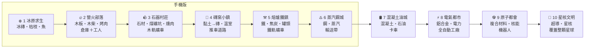

# 寒霜小鎮（暫名）— 重現評估與製作流程

> 參考來源：使用者提供的影片 `813672056.446233.mp4`（3 分 24 秒，手機直式）
> 評估日期：2026-10-14

---

## 1. 影片裡的遊戲在做什麼（拆解）

影片是《寒霜啟示錄 Whiteout Survival》的**試玩廣告**（畫面左上有「立即遊玩」按鈕）。
注意：真正的《寒霜啟示錄》是多人戰略遊戲，影片裡這種玩法只存在於廣告中——這類玩法業界叫做
**「放置街機（Idle Arcade）／揹物堆疊經營」**，類似《My Perfect Hotel》《伐木工廠》這類手遊。

| 看到的畫面 | 實際機制 |
|---|---|
| 左下角半透明圓圈 | 虛擬搖桿，單指拖曳移動角色 |
| 角色身邊旋轉的斧頭／刀光 | **自動攻擊**：靠近樹就砍、靠近熊就打，不用按按鈕 |
| 角色背上越疊越高的木頭／肉／鈔票 | **揹物堆疊**：資源疊在背上，有容量上限 |
| 地上虛線方框＋泡泡數字（例：木頭 6） | **投放點**：走過去自動卸貨，數字是還需要幾個 |
| 排隊的藍色小人 | **顧客／村民**：送肉給他們 → 他們付錢（綠色鈔票堆） |
| 地上寫著 15、40、85、100 的格子 | **解鎖格**：站上去自動扣錢 → 蓋出新建築／圍欄／砲塔 |
| 北極熊、野豬、紅色血量條 | 野獸會攻擊圍欄；打死掉肉 |
| 圍欄上的弩砲塔 | 買下後**自動射擊**野獸（第一個自動化） |
| 鐵軌、礦車、金條 | 後期新資源線：挖礦 → 礦車自動運送 |
| 右上角四種資源（鈔票／木頭／肉／金條） | 資源列 |
| 雪霧邊界逐步打開 | 地圖擴張 |

**核心循環（一句話）**：走去採集 → 揹回來 → 卸到工作站換錢 → 用錢解鎖新區域和自動設施 → 走更遠採更多。

---

## 2. 你要的方向：「在寒地擴張領地」＋「模擬城市」＋「單人操作」怎麼平衡

影片玩法的問題：**全程都靠你親自跑腿**，玩 30 分鐘就會累，也沒有「經營城市」的感覺。
模擬城市的問題：**只有上帝視角規劃**，沒有角色、手感比較冷。

### 建議：三層玩法，隨遊戲進度「把手上的工作交出去」

```
前期（0–20 分）   中期（20–60 分）        後期（60 分以後）
親手做 ──────────► 雇人做 ──────────────► 規劃城市
主角砍樹打熊        買工人、礦車、砲塔        自由擺放建築、管理暖氣與人口
跑腿送貨            主角改去「開新地」        主角負責探索、打頭目、救災
```

**黃金原則：「每件事都先親手做過一次，之後才能買自動化。」**
- 好處 1：親手做 = 教學，玩家不用看說明就懂每個建築在幹嘛。
- 好處 2：買自動化時有「終於不用自己跑了」的爽感。
- 好處 3：主角永遠有事做——自動化接手舊區域，主角去推進新邊界。

### 加入「寒冷」讓它像模擬城市（我們自己的特色，不是照抄）

| 系統 | 說明 | 帶來的經營決策 |
|---|---|---|
| **中央火爐** | 城鎮中心的大火爐，燒木頭產生暖氣圈 | 建築放在暖氣圈內才能運作 → 要規劃擺位 |
| **暖氣範圍升級** | 火爐升級，暖圈變大 | 領地擴張＝暖氣擴張，畫面很直觀 |
| **村民需求** | 食物、住屋、溫暖三條 | 缺任何一個，村民會生病／離開 |
| **寒潮事件** | 每隔幾天溫度驟降、野獸成群來襲 | 平時要存木頭、蓋圍欄砲塔 → 緊張感 |
| **村民職業分配** | 伐木工、獵人、礦工、廚師 | 模擬城市式的「人力分配」 |

### 單人操作 vs 經營的比例目標

| 階段 | 親手操作 | 經營規劃 |
|---|---|---|
| 前期 | 80% | 20% |
| 中期 | 50% | 50% |
| 後期 | 25%（探索、打頭目、救災） | 75% |

---

## 3. 需要的軟體（全部免費）

| 用途 | 軟體 | 說明 | 你需要做的事 |
|---|---|---|---|
| 遊戲程式 | **Three.js**（網頁 3D） | 跟「校園對戰」同一套，單一 HTML 檔，用 Chrome 開就能玩 | 不用裝，Claude 寫好你直接開 |
| 3D 模型（主要） | **Kenney.nl** 免費素材包 | 低多邊形（low-poly）風格、可商用（CC0 授權＝免費隨便用） | 下載指定的素材包，解壓到 `assets/` |
| 3D 模型（動物、角色） | **Quaternius**（quaternius.com） | 免費、CC0、有動畫的動物和人物 | 同上 |
| 模型修改（選用） | **Blender** | 改顏色、合併模型；新手可以先不用 | 後期才需要 |
| 音效 | **jsfxr**（網頁產生器）、Kenney 音效包 | 砍樹、撿錢、升級音效 | 不用裝 |
| 版本管理 | **Git ＋ GitHub** | 你已經有了 | 照舊：看 PR、按合併 |
| 手機測試 | **GitHub Pages** | 把遊戲放上網，手機直接開網址玩 | 在 GitHub 設定裡開一次 |
| 之後上架（選用） | Godot 4 或 Capacitor | 要做成 App 再考慮 | 現在不用 |

**為什麼推薦 Three.js 而不是 Godot？**
- 你已經在「校園對戰」用過，流程熟
- 一個 HTML 檔，Claude 改完你按重新整理就看到結果，最快
- 可以直接放上你的「遊戲網站」讓人玩
- 缺點：要上架 App Store 比較麻煩（真的要上架時再說）

---

## 4. 製作流程（里程碑）

每個里程碑結束都會開一個 PR 給你檢查、試玩、合併。

| 階段 | 內容 | 你要做的 | 預估對話次數 |
|---|---|---|---|
| **M0 企劃** | 本文件；決定名稱、引擎、方向 | 回答下方「待決定」 | 1 |
| **M1 灰盒原型** | 全部用方塊：搖桿移動、自動砍樹、背上堆木頭、卸貨、站格子花錢解鎖 | 用 Chrome 試玩「手感」 | 2–3 |
| **M2 第一區完整** | 木頭 → 鋸木廠；打熊 → 肉 → 廚房 → 排隊村民付錢；圍欄＋弩砲 | 試玩、回報哪裡太慢太快 | 3–5 |
| **M3 換上美術** | 換成 low-poly 模型、雪地、粒子特效、音效 | 下載素材包 | 3–4 |
| **M4 自動化層** | 雇工人、礦車、軌道、金礦 | 試玩 | 3–4 |
| **M5 城市經營層** | 中央火爐暖氣圈、自由擺放建築、村民需求、寒潮事件 | 試玩、決定平衡 | 5–8 |
| **M6 打磨上線** | 數值平衡、存檔、手機觸控、放上 GitHub Pages／遊戲網站 | 手機試玩 | 3–5 |

**M1 是最重要的一步**：這類遊戲好不好玩，90% 取決於「走路→自動砍→東西飛到背上」的手感。手感不對，後面做再多都沒用。

---

## 5. 數值平衡的起點（之後試玩再調）

| 項目 | 建議起始值 | 原因 |
|---|---|---|
| 前 5 個解鎖的間隔 | 每 20–40 秒解鎖一個 | 讓新手一直有成就感 |
| 中期解鎖間隔 | 2–5 分鐘 | 開始需要自動化才跟得上 |
| 解鎖價格成長 | 每個比上一個貴 1.3–1.5 倍 | 業界常見曲線 |
| 背包容量 | 起始 10，可升級到 50+ | 背上的塔越來越高＝視覺爽感 |
| 自動化效率 | 工人速度約主角的 50–70% | 主角親自做仍然比較快，保留操作意義 |

---

## 6. 版權注意

- **不能用**：《寒霜啟示錄》的名字、Logo、角色、美術、介面設計
- **可以做**：「揹物堆疊＋解鎖擴張」這種玩法機制（玩法本身沒有著作權，市面上很多同類遊戲）
- 所有模型用 CC0 素材或自己做，名字用我們自己取的

---

## 7. 待你決定

1. **遊戲名稱**：先用「寒霜小鎮」當暫名可以嗎？
2. **引擎**：Three.js 網頁版（推薦）還是 Godot？
3. **畫面方向**：照影片的直式手機畫面，還是橫式電腦畫面？（影響操作：直式＝搖桿，橫式＝WASD 鍵盤）
4. **是否建 GitHub 儲存庫**：建議名稱 `frost-town`

---

## 8. 城市成長藍圖（2026-10-16 作者確認方向）

> ⚠️ 2026-10-17：城市等級和時代改以第 11 節「十個時代藍圖」為準。

參考模擬城市：**最重要的是「人口到門檻就解鎖新東西」**，讓玩家一直有「再一下就到下一級」的動力。原本「親手做 → 雇人做 → 規劃城市」的三層玩法往上延伸成五個城市等級。

### 8.1 五個城市等級

| 等級 | 人口 | 主角在做什麼 | 新玩法 | 鏡頭 |
|---|---|---|---|---|
| 1. 營地（v0.22 現況） | 0–20 | 親手砍樹、打熊、送貨 | 鋸木廠、烤肉攤、北門防守 | 很近 |
| 2. 村莊 | 20–80 | 開始雇人，自己去開新地 | 蓋民房（人口來源）、中央火爐暖氣圈 | 稍遠 |
| 3. 小鎮 | 80–300 | 探索礦山、冰湖 | 規劃模式（格子擺放）、煤礦、雪道、運貨雪橇 | 可切換主角／規劃視角 |
| 4. 城市 | 300–1500 | 打頭目、救災 | 住宅／工坊／市集三種區域、稅收、滿意度 | 遠 |
| 5. 大城市 | 1500+ | 開拓新殖民地 | 蒸汽管線、鐵路、奇觀建築、城鎮間貿易 | 很遠 |

每次升級要有隆重的「升級時刻」：城門換新、鏡頭拉遠、跳出「新解鎖」卡片。

### 8.2 模擬城市系統的寒地版

| 模擬城市 | 寒霜小鎮版本 |
|---|---|
| 電力／水覆蓋範圍 | 暖氣圈：建築在火爐、暖氣塔範圍內才運作 |
| 住商工區＋需求條 | 民房、工坊、市集，三條需求條提示缺什麼 |
| 道路交通 | 雪道會積雪，要鏟雪車或主角清 |
| 稅收預算 | 一個稅率滑桿：稅高錢多、村民不開心 |
| 災害 | 寒潮、熊群、暴風雪、火災 |
| 地價 | 溫暖度＋熱鬧度：靠近火爐、市集的民房會自己升級變漂亮 |

### 8.3 不無聊的設計
1. **10 分鐘法則**：每 10～15 分鐘解鎖一個新東西（用人口門檻控制）
2. **新地區＝新的親手玩法**：冰湖釣魚、礦山挖煤、港口捕鯨，都先親手做再自動化
3. **城市特色二選一**：城市級選伐木城／礦業城／觀光城，各有不同奇觀
4. **奇觀建築**：分段蓋的長期目標，蓋好有永久加成
5. **離線收入**：關掉遊戲城市照樣賺，回來先領
6. **成就與城市相簿**：達成目標拍照收藏，可放遊戲網站

### 8.4 模式：先主線、後沙盒
- **主線**：5 章對應 5 個等級，每章 3 個目標（例：人口到 80、撐過第一次寒潮、蓋好煤礦），1～3 顆星評分
- **無限沙盒**：主線過完第 2 章解鎖；用已解鎖的建築自由蓋；可調起始資金、災害開關／強度、地圖大小
- 只做沙盒：一開始不知道要做什麼；只做關卡：打完就結束 → 兩種都要

### 8.5 技術現實
- 人口用數字表示，畫面只放幾十個代表性村民（手機效能）
- 規劃模式用格子擺放，點格子就蓋
- 做到城市級時 `index.html` 可能要拆成幾個檔案（仍然不需要建置）

### 8.6 新里程碑（取代第 4 節的 M4～M6）

| 里程碑 | 內容 |
|---|---|
| M4 村莊（**下一步**） | 民房與人口、中央火爐暖氣圈、城市等級升級畫面 |
| M3 換美術 | 延後到 M4 之後 |
| M5 小鎮 | 規劃模式（格子）、煤礦、雪道、寒潮 |
| M6 主線第 1～3 章 | 章節目標、星星評分 |
| M7 城市 | 三種區域與需求條、稅率、滿意度 |
| M8 沙盒模式＋離線收入 | |
| M9 大城市 | 奇觀建築、新殖民地 |

### 8.7 地圖變大後的視角（作者 2026-10-17 回饋）
- 參考影片與模擬市民：地區越大能蓋越多，但需要越多地；鏡頭會越拉越遠、人物看起來越來越小，但要有**極限**（人物不能小到看不清）
- 城市大到一定程度（建議：城市等級、人口 300）解鎖「🗺️ 全圖視角」：
  - 像星海爭霸的俯視角，看得到整張地圖
  - 用點選下指令：指定工人去哪裡砍樹、挖煤、鏟雪，指定弩砲塔防守哪個門，規劃模式直接在全圖蓋
  - 隨時可以切回原本跟著主角的視角（但那個視角看不到全貌）
- 目前做到：v0.34 營火升級擴大領地時鏡頭稍微拉遠；城市等級要做的時候一起做全圖視角

## 9. 城鎮地塊、營火進化、存檔（作者 2026-10-17 第二次試玩回饋後確認）

### 9.1 城鎮地塊系統（解決穿模、圍欄擋路、分區、道路）
- 營地分成一圈圈「地塊」，每個地塊只放一個東西；中央是營火廣場
- 每個建築有自己的地塊，它的升級付款格固定在建築門口前的小空地，建築、圖示、付款格不互相擋
- 擴大領地＝多開一圈地塊，圍欄推到新那圈外面；民房、煤礦都蓋在圍欄裡
- 分區：民房區、加工區（鋸木廠、烤肉攤）、工業區（煤礦、鐵匠鋪）、防禦區（弩砲塔）
- 蓋好建築自動從門口鋪石板路接到廣場或最近的路，路網越來越密、越像城鎮

### 9.2 模式
| 模式 | 怎麼蓋 |
|---|---|
| 教學關（現在的試玩版） | 建築位置固定，跟著目標提示一步步蓋，不能自己選 |
| 正式關卡：自己蓋 | 規劃模式選地塊，同一區的地塊蓋同類建築 |
| 正式關卡：交給電腦（託管） | 電腦照分區自動挑地塊，玩家只決定要蓋什麼 |
| 無限沙盒 | 主線過第 2 章解鎖（見 8.4） |

### 9.3 營火進化：每 3 級換一次型態，7 個時代、21 級
| 等級 | 型態 | 燃料 | 解鎖 | 外觀／暖氣圈 |
|---|---|---|---|---|
| 1–3 | 🔥 營火 | 木頭 | 鋸木廠、烤肉攤、弩砲塔 | 石頭圍柴堆／橘色火光 |
| 4–6 | 🪨 石爐 | 木頭＋煤 | 煤礦、鐵匠鋪、暖氣塔 | 石砌大火爐 |
| 7–9 | ♨️ 蒸汽鍋爐 | 煤 | 蒸汽管線、礦車軌道 | 鐵鍋爐冒白煙／白色蒸汽 |
| 10–12 | 🛢️ 燃油爐 | 石油 | 油井、卡車、機械化伐木 | 油槽與煙囪 |
| 13–15 | ⚡ 發電廠 | 燃油→電 | 電網、電暖器、路燈、工廠 | 燈光亮起／藍色電光 |
| 16–18 | ☢️ 核能反應爐 | 鈾 | 自動化工廠、雪地機器人 | 冷卻塔、藍光 |
| 19–21 | 🌟 星核（科幻） | 核融合／能量晶體 | 浮空建築、能量護盾取代圍欄、無人機 | 懸浮能量球／紫色能量場 |
- 燃料越高級越耐燒，但要專門的生產鏈 → 「把跑腿交給機器」
- 熊群跟著時代升級（雪怪、冰原機械獸）

### 9.4 無限模式長時間存檔
- 存檔只有幾 KB，上萬棟建築約 300 KB，手機瀏覽器每站約 5 MB，每 2 秒存一次幾乎沒負擔
- 真正吃算力的是畫面：同種建築合併繪製（批次繪製）、村民用數字算只畫幾十個、離線收入用公式算
- 風險是存檔被清掉（iPhone Safari 7 天沒開可能清資料）→ 教玩家「加入主畫面」＋做「匯出／匯入存檔碼」，之後可接遊戲網站雲端存檔

### 9.5 製作順序
1. v0.36～v0.38 城鎮地塊系統（試玩版直接變成教學關佈局）
2. v0.39～v0.40 營火進化前兩個時代（營火 → 石爐），v0.40 電腦版檢查
3. 存檔碼匯出／匯入（穿插）
4. 之後：正式關卡的自己蓋／託管、更後面的時代、全圖視角

## 10. 怪物升級與災難（作者 10/17：熊太弱，要更強的怪物和災難）— 草案，待作者確認

### 10.1 怪物跟著營火時代（每 3 級換一批，對應 9.3）
| 營火等級 | 時代 | 新怪物 | 特色 | 對策 |
|---|---|---|---|---|
| 1–3 | 🔥 營火 | 北極熊（現在） | 撞門、野外追人 | 弩砲塔、修門 |
| 4–6 | 🪨 石爐 | 🐺 冰狼群 | 一次 4～6 隻、跑很快、會繞到東門／南門 | 第二道門、更多弩砲塔 |
| 4–6 | 🪨 石爐 | 🐻‍❄️ 熊王（首領） | 血多 5 倍、撞門傷害 3 倍，每 3 波出現一次 | 集中砲火、打倒掉大量肉和錢 |
| 7–9 | ♨️ 蒸汽 | ❄️ 雪怪 | 丟冰塊打建築（遠程）、會凍住暖氣塔 | 投石塔、暖氣塔保護 |
| 10–12 | 🛢️ 燃油 | 🦣 長毛象群 | 直接衝撞圍欄（不一定走門） | 石牆、陷阱 |
| 13 以後 | ⚡～🌟 | 冰原機械獸、冰龍 | 首領戰 | 電網、能量護盾 |

### 10.2 災難：每 5 次升級來一次（營火升級、城市升級、擴大領地都算）
| 災難 | 發生什麼 | 怎麼撐過 |
|---|---|---|
| 🌨️ 大暴雪 | 60 秒：視線變短、雪堆積 5 倍快、主角走路慢 | 鏟雪工、倉庫存柴 |
| 🧊 極寒夜 | 90 秒：營火燒 4 倍快、暖氣圈只剩一半 | 倉庫存煤、自動運輸「進倉庫」 |
| 🐾 獸潮 | 連續 3 波怪物，最後一波有首領 | 弩砲塔、修好北門 |
| 🔥 火災 | 一棟建築著火，不救會燒到隔壁 | 揹雪或木頭去救（或水井） |
| ⛏️ 礦坑崩塌 | 煤礦停產 60 秒 | 倉庫要先存煤 |
- 來之前 30 秒預告（畫面上方倒數＋說明對策），撐過去給大獎金
- 災難輪流出現，越後面越難；教玩家「平常要存資源、要蓋防禦」

### 10.3 建議製作順序
1. v0.56 熊群隨營火等級變強（血量、撞門傷害、數量），石爐時代加入冰狼群
2. v0.57 災難系統＋第一個災難「大暴雪」（升級計數、預告、獎金）
3. v0.58 熊王首領
4. 之後：極寒夜、獸潮、火災、雪怪…

## 11. 十個時代藍圖（作者 2026-10-17 第三次回饋；10/18 確認時代表）

> 這一節是之後所有開發的總綱。第 8.1 節（五個城市等級）、9.3 節（營火 7 個時代）、10.1 節（怪物）都改以這一節為準。
> 作者的 8 點回饋對應：第 6 點 → 11.1～11.2；第 1 點 → 11.3～11.4；第 4、5 點 → 11.5；第 7 點 → 11.6；第 2、3 點 → 11.7；第 8 點 → 11.8～11.9。

### 11.1 主軸：一顆冰凍星球，從剷雪求生到改造整個星球
- 像《世紀帝國》升時代：每個時代換一種**核心火源**、一種**新建材**、一種**新燃料**、一種**新食物**、一個**新的自動化等級**
- 每個時代都是「先親手做 → 雇工人做 → 交給機器做」，下一個時代的新資源又從親手做開始（這就是遊戲的節奏）
- 核心火源（營火的後代）永遠在城市中央：它是**暖氣**、**時代升級的地方**、也是**倉庫自動補燃料的對象**
- 終點：城市蓋滿整顆星球、把冰星變成暖星

### 11.2 十個時代（作者 2026-10-18 確認版：材料一代接一代）
**核心規則：上一代的建材，蓋出下一代材料的加工廠。** 可以用現實簡化，但不能違反常理（木頭不會變磚頭：磚要黏土燒，燒磚的窯要石頭砌，所以先有石器時代才有磚）。

| # | 時代 | 新建材（從哪來） | 加工廠用什麼蓋 | 燃料 | 食物 | 住屋 | 自動化 | 新威脅 |
|---|---|---|---|---|---|---|---|---|
| 1 | ❄️ 冰原求生 | 冰磚（雪用手壓） | 不用（徒手） | 枯枝 | 魚（冰洞釣） | 冰屋 | 全部親手 | 寒夜、暴風雪 |
| 2 | 🔥 營火部落（**現在的版本**） | 木板（樹 → 原木 → 鋸木廠） | 原木 | 木柴 | 烤熊肉 | 木屋 | 倉庫＋工人 | 北極熊 |
| 3 | 🪨 石器村莊 | 石材（採石場切石） | 木板（木架） | 煤（礦坑） | 燻肉（能久放） | 石屋 | 雪橇運輸、**木軌礦車** | 冰狼群、熊王 |
| 4 | 🧱 磚窯小鎮（新加） | 磚（黏土＋磚窯燒煤） | **石材**（窯要石頭砌） | 煤 | 溫室蔬菜（磚牆＋窯燒的玻璃） | 磚屋 | 推車道路 | 雪怪（丟冰塊） |
| 5 | ⚒️ 熔爐鐵鎮 | 鐵（鐵礦坑＋熔爐） | **耐火磚**（熔爐要磚砌） | 焦炭（煤烤成） | 罐頭（有鐵才有罐子） | 磚屋加鐵屋頂 | **鐵軌礦車**、鐵匠鋪工具 | 長毛象群（撞圍欄） |
| 6 | ♨️ 蒸汽鋼城（**手機版終點**） | 鋼（鐵＋焦炭＋蒸汽鼓風） | **鐵**（鍋爐是鐵做的） | 蒸汽（燒煤） | 罐頭工廠 | 鋼骨公寓 | 輸送帶 | 冰原機械獸 |
| 7 | 🛢️ 混凝土油城 | 混凝土（石灰石燒水泥＋砂石＋鋼筋） | 鋼（水泥窯、鑽油管） | 石油 | 加工食品 | 大樓 | 卡車 | 極光風暴（停電） |
| 8 | ⚡ 電氣都市 | 鋁合金（煉鋁一定要用電） | 混凝土（發電廠） | 電力 | 冷凍食品 | 高樓 | 全自動工廠 | 冰龍（首領） |
| 9 | ☢️ 原子都會 | 複合材料 | 合金＋混凝土（反應爐外殼） | 核燃料 | 水耕農場 | 生態大樓 | 機器人 | 冰河崩裂 |
| 10 | 🌟 星核文明 | 超導材料（要極低溫，冰星球反而是優勢） | 複合材料 | 核融合 → 星核 | 合成食物 | 穹頂都市 | 無人機，覆蓋整顆星球 | 星球最終寒潮 |

**建築升級＝換更好的材料重蓋**，只能換成已經做得出來的材料：
- 民房：冰屋 → 木屋 → 石屋 → 磚屋 → 鋼骨公寓 → 混凝土大樓
- 圍欄：雪牆 → 木柵欄 → 石牆 → 磚牆 → 鐵門 → 混凝土牆
- 中央火源：小火堆 → 營火 → 石爐 → 磚砌大壁爐 → 熔爐 → 蒸汽鍋爐 → 燃油爐 → 發電廠 → 反應爐 → 星核
- 舊材料不消失：木頭之後還是鷹架、木柴，交給工人

**資源要有形象（作者 10/18）**：資源從它在現實裡的地方來，不是地上冒出一堆
- 樹：保留現在的雪松造型；不同樹種給不同木材（細節待作者決定，見 11.11）
- 煤、鐵：**礦坑**（山壁、木框坑口），主角在坑口挖；升級後有礦車沿軌道把礦送出來（第 3 時代木軌、第 5 時代鐵軌）
- 石材：採石場（切開的岩壁）；黏土：河岸／凍土挖開的土坑；石油：油井
- 舊表要改的地方：「鐵匠鋪」移到第 5 時代（第 3 時代沒有鐵）；礦車軌道從第 4 移到第 3（木軌）／第 5（鐵軌）

- 每個時代的核心火源有 3 級；升滿 3 級＋達到人口門檻＋交出新建材，就能升下一個時代
- 第 1～6 時代：手機版（一座城、3D 近距離鏡頭）。**手機版做到第 6 時代就算完整**
- 第 7～10 時代：多城市、地區／大陸／星球地圖，之後再決定
- 舊存檔相容：舊存檔直接當成第 2 時代

### 11.3 三條資源線：每種材料都有去處（作者第 1 點）
每個時代只有 **建材／燃料／食物** 三條線＋人口＋錢，不會出現「做出來但沒用」的東西：

| 線 | 誰在用 | 不夠會怎樣 |
|---|---|---|
| 🧱 建材 | 蓋建築、升級建築、修門、升級核心火源、升時代 | 蓋不了、修不了 |
| 🔥 燃料 | 核心火源和暖氣（倉庫自動補） | 暖氣圈縮小、建築凍住停工、熊群變多 |
| 🍖 食物 | 人口成長；工人每分鐘吃一點 | 人口不會長、工人罷工 |
| 👥 人口 | **每個工人＝1 個人口**；人口到門檻才能升時代 | 雇不到工人 |
| 💵 錢 | 雇工人、買工具升級；用多出來的材料去市集換 | 只能自己親手做 |

- 規則：**建築用材料蓋**（像世紀帝國），錢只拿來雇人和交易 → 鋸木廠、鐵匠鋪不再只是「換錢機」
- 材料從哪來 → 加工成什麼 → 被誰用掉，全部寫在 11.4 的表裡；表上找不到用途的建築就不做

### 11.4 建築總表（每棟都說得出用途）
| 時代 | 建築 | 輸入 → 輸出 | 被誰用 | 現在版本對應 |
|---|---|---|---|---|
| 1 | 小火堆 | 枯枝 → 暖氣 | 核心 | 新增 |
| 1 | 冰磚工坊 | 雪 → 冰磚 | 冰磚屋、雪牆 | 新增（鏟雪終於有用） |
| 1 | 冰洞 | → 魚 | 人口成長 | 新增 |
| 1 | 冰磚屋 | 冰磚 → 住 2 人 | 人口 | 新增 |
| 2 | 營火 | 木柴 → 暖氣 | 核心 | 營火 ✅ |
| 2 | **倉庫（第一棟要蓋的）** | 收工人送來的東西，自動補火、修門、付建材 | 全部 | 現在要買「自動運輸：進倉庫」才有 → 改成第 2 時代一開始就蓋 |
| 2 | 鋸木廠 | 木頭 → 木材（建材）＋木柴（燃料） | 木屋、圍欄、營火 | 現在是木頭換錢 → 改 |
| 2 | 烤肉攤 | 熊肉 → 烤肉 | 人口成長、工人吃 | 現在賣給村民換錢 → 改成食物＋多的才賣 |
| 2 | 木屋（民房） | 木材 → 住 5 人 | 人口＝工人 | 民房 ✅（人口終於有用） |
| 2 | 伐木小屋／獵人小屋 | 雇工人 → 自動砍樹／打熊，送進倉庫 | 倉庫 | 伐木工 ✅、獵人新增 |
| 2 | 鏟雪站 | 雇工人 → 清路上的雪，雪送冰磚工坊 | 冰磚工坊 | 鏟雪工 ✅ |
| 2 | 弩砲塔、北門 | 木材 → 防禦 | 擋熊 | ✅ |
| 2 | 市集 | 多的材料 ↔ 錢 | 雇人的錢 | 自動運輸「換錢」改成市集 |
| 3 | 石爐 | 煤 → 暖氣（大範圍） | 核心 | 石爐 ✅ |
| 3 | 採石場、煤礦 | → 石材、煤 | 石屋、石爐 | 煤礦 ✅、採石場新增 |
| 3 | 鐵匠鋪 | 煤＋石材 → 工具 | **工人效率 +50%**、斧頭鎬子升級 | 現在煤換錢 → 改 |
| 3 | 燻製屋 | 魚、肉＋木柴 → 燻製品（不會壞） | 寒潮、災難時的存糧 | 新增 |
| 3 | 暖氣塔 | 煤 → 局部暖氣 | 遠處建築不凍住 | ✅ |
| 3 | 雪橇站 | 雇工人 → 倉庫之間自動搬運 | 第二個倉庫（礦區） | 自動運輸 → 改 |
| 4 | 熔爐、鐵礦、焦炭窯、溫室、礦車站、投石塔 | 見 11.2 | | 之後 |
| 5 | 蒸汽鍋爐、鋼廠、輸送帶、罐頭工廠、蒸汽管線（取代暖氣塔） | 見 11.2 | | 之後 |

- 舊建築「第二台鋸木機」「背包擴充」「斧頭升級」→ 變成建築的升級等級或鐵匠鋪的工具，不再單獨一格
- 「自動運輸：換錢／進倉庫」二選一 → 拆成「倉庫」（第 2 時代必蓋）＋「市集」（換錢），不用再二選一

### 11.5 自動化階梯：每種材料都一樣（作者第 4、5 點）
| 級 | 怎麼收集 | 需要什麼 | 時代 |
|---|---|---|---|
| 0 | 主角親手揹 | — | 每個時代的新材料 |
| 1 | 工人 | **倉庫**＋1 人口（住屋）＋食物 | 2 起 |
| 2 | 運輸隊（雪橇、礦車） | 兩個倉庫之間、要路或軌道 | 3、4 |
| 3 | 輸送帶 | 生產建築直接連加工建築，不用經過倉庫 | 5 |
| 4 | 全自動工廠 | 電力 | 7 |
| 5 | 機器人、無人機 | 核能以上 | 8 起 |

- **倉庫一定要先蓋**：工人採的東西送進倉庫；倉庫自動餵核心火源、修門、付建築材料 → 自動化有意義
- 每升一級自動化，主角就有空去做下一個時代的新材料（親手）→ 玩家永遠有事做，但不用重複舊工作

### 11.6 畫面簡化：高級資源取代低級資源（作者第 7 點）
- 手機版左下背包只顯示 **3 格：🧱 建材、🔥 燃料、🍖 食物**，每格顯示「這個時代最高級」的那種
  - 例：第 3 時代背包顯示 石材／煤／燻製品；木頭還是有，但已經交給工人和倉庫，不佔畫面
- 低級資源完全自動化後，從背包和頂部消失，只在倉庫的標籤看得到
- 電腦版（之後分出來）螢幕大：可以全部列出、看每條生產鏈的數字；**現在還是一個版本**，先做手機的簡化方式

### 11.7 城鎮重新規劃：不穿模、不重疊、可以搬（作者第 2、3 點）
**現在的問題**：圍欄半徑只有 9～18.5 格，建築越蓋越擠；標籤和付款格蓋到別的建築或道路；人物會穿過建築；鋸木廠、烤肉攤、煤礦等用付款格蓋的建築位置寫死，按住不能搬（只有用🏗️規劃蓋的能搬）。

**新做法**
1. **大格子城鎮**：整個城鎮是方格（1 格＝2×2），建築佔 1×1、2×2 或 3×3 格；每棟建築門口多留 1 格「門口格」放付款格和標籤，別人不能蓋
2. **道路網**：中央火源廣場 → 4 條放射主幹道 → 一圈圈環狀路；道路是格子，建築不能蓋在路上，路上不放標籤
3. **分區一圈一圈往外**：內圈住宅、中圈加工（鋸木廠、烤肉攤、市集）、外圈工業（礦、鐵匠鋪）和防禦（門、砲塔）
4. **城鎮大小跟時代走**：第 1 時代約 12×12 格，第 2 時代 24×24，第 3 時代 40×40，第 5 時代 80×80；鏡頭拉遠有極限，超過就用全圖視角（v0.50 已有）
5. **碰撞**：每棟建築有實體範圍，主角、村民、工人都繞著走；工人沿著道路走
6. **標籤不打架**：平常只顯示小圖示；靠近或在規劃模式才顯示文字；同一時間最多顯示附近 6 個
7. **全部可以搬**：除了中央火源，**每一棟建築（包括剛蓋好的、原本寫死位置的）都能長按搬家**；所有建築都從🏗️規劃蓋，付款格只用來「升級」已經蓋好的建築

### 11.8 現在的程式能不能沿用？（作者第 8 點）
| 部分 | 判斷 |
|---|---|
| 主角移動、揹東西堆疊、搖桿、鏡頭、熊、砲塔、營火畫面、寒潮、存檔碼 | ✅ 可以沿用 |
| 建築系統 | ❌ 每棟建築各寫一段、位置寫死、存檔用一堆開關（`save.mine`、`save.tower2`…）→ 改成「建築資料表」：每種建築的時代、大小、輸入輸出、升級，一張表管全部 |
| 資源 | ❌ 木頭／肉／煤各自寫死 → 改成「資源資料表」＋三條線，倉庫用同一套 |
| 城鎮地圖 | ❌ 圓形圍欄＋寫死座標 → 改成大格子＋道路網（11.7） |
| 程式檔案 | 1900 行的單一 `index.html` 已經很難改 → 建議拆成幾個 `.js` 檔（仍然不用建置，直接開就能玩） |

**建議：新架構，但不是從零開始** — 把「建築、資源、地圖」三塊換成資料表的新寫法，其他沿用。改的期間網站上的舊版照常能玩，新架構追上第 2 時代內容後再換掉。舊存檔自動轉成第 2 時代。

### 11.9 製作順序（取代 10.3）
| 階段 | 版本 | 內容 |
|---|---|---|
| A 新骨架 | v0.57～v0.60 | 拆檔；建築資料表、資源資料表；大格子城鎮＋道路網＋碰撞；所有建築從規劃蓋、都能搬；標籤不重疊。v0.60 電腦版檢查 |
| B 第 2 時代重做 | v0.61～v0.65 | 倉庫優先、三條資源線、建築用材料蓋、市集、工人吃食物；舊存檔轉換。v0.65 自動發布（v0.61～v0.63 已完成倉庫、三條線、材料蓋、工人吃食物） |
| C 第 1 時代（新開場） | v0.66～v0.70 | 剷雪、冰磚、冰磚屋、釣魚、小火堆 → 升營火進第 2 時代 |
| D 第 3 時代 | v0.72～v0.80 | 煤礦坑＋木軌礦車（v0.72 起）、採石場、石材、石屋、燻製屋、雪橇運輸、冰狼、熊王、災難系統（第 10 節） |
| E 第 4～6 時代 | v0.81～v1.00 | 黏土、磚窯、磚屋 → 熔爐、鐵礦坑、鐵軌礦車、鐵匠鋪 → 蒸汽、鋼、輸送帶 → **手機版 1.0 完整** |
| F 第 7～10 時代 | 之後 | 電腦版、多城市、星球地圖，評估換軟體 |

### 11.10 心智圖


### 11.11 待作者決定
1. ~~十個時代的名稱和內容~~ → 10/18 確認（11.2）
2. 不同樹種給不同木材：要分哪幾種、各有什麼用？（見 11.2「資源要有形象」）
